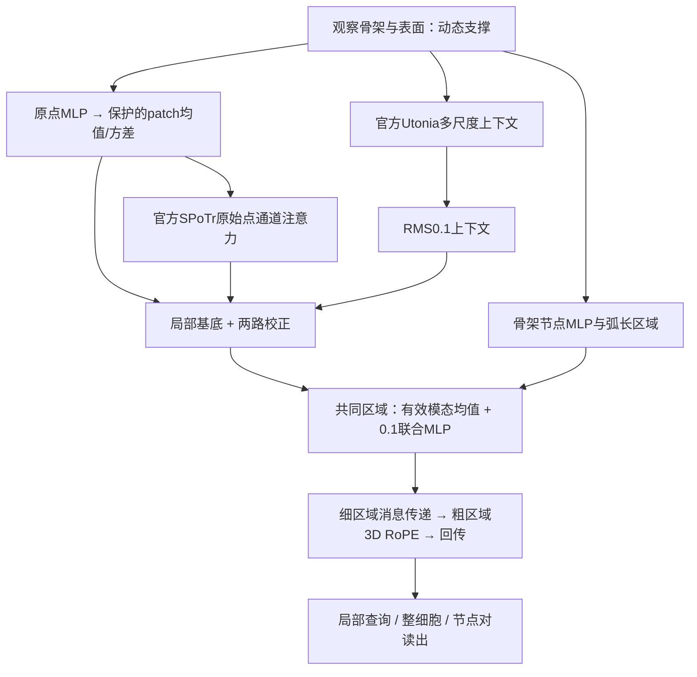

# CRSS: Common-Region Skeleton–Surface Encoding

神经元骨架—表面联合表征研究。**当前参照为R28（2026-10-20）**：在R9共同区域主干上加入SPoTr官方局部通道注意力，保留原局部统计、Utonia RMS0.1上下文、动态分辨率与物理位置/尺度编码。五任务分别从零训练，不用外部预训练。

**从 [START_HERE.md](START_HERE.md) 开始。**

| 内容 | 入口 |
|---|---|
| R28网络图、关键模块及每个模块最相关论文 | [架构与来源](docs/R28_ARCHITECTURE_ZH.md) |
| R28五任务及完整baseline表 | [结果说明](docs/R28_RESULTS_ZH.md)、[JSON](code/r28/BASELINE_COMPARISON.json)、[CSV](code/r28/BASELINE_COMPARISON.csv) |
| 原始冻结源、三个已完成权重、验收/版本证据 | [R28代码包](code/r28/README.md) |
| H01实际入口 | [R28模型](code/r28/reference/tools/cpsf_raw_point_attention/model.py) |
| FlyWire/TED/TLP适配 | [扩展模型](code/r28/extension/tools/cpsf_r28_expansion/model.py) |
| 共享的原R9共同区域/上下文实现 | [模型主干](code/r28/reference/tools/cpsf_utonia_context/model.py) |
| 历史R9与2026-10-11模型 | [R9原归档](code/r9/README.md)、[更早模型](code/README.md) |
| 旧版论文草稿 | [论文](paper/main.tex)，尚未按R28重写 |

## 当前结果

截至2026-10-20 09:41北京时间，固定seed42、固定最终轮开发集：

| 任务 | R28 | 当前最强纳入外部baseline |
|---|---:|---:|
| H01局部Macro-F1↑ | **0.663894** | GraPHFormer-adapted 0.637270 |
| H01整体MAE↓ | **0.048891** | SGFormer 0.058459 |
| FlyWire六super_class分类 | 训练中，17/50轮 | Utonia scratch R2 0.785536 |
| TED正类F1↑ | 训练中，10/30轮 | TED-Net 0.569248；统一argmax 0.568330 |
| TLP缺边Macro-AP↑ | **0.569710** | SGFormer 0.551245 |

三项已完成结果优于当前纳入外部对照，但相对历史R9，H01局部从0.667901降到0.663894；整体与TLP改善。没有五任务普遍SOTA证据。PointMamba、Exphormer不作正式baseline。FlyWire是分类，不是检索。所有表格不混入测试成绩、外部预训练或其他版本最佳值；最新状态见[RESULTS.json](code/r28/RESULTS.json)。



## 校验与使用边界

```bash
python scripts/verify_r28.py
python scripts/verify_r9.py
python scripts/verify_export.py
```

上述是标准库原始字节/版本/发布一致性检查。五模型已在原服务器环境完成发布源构造，三个已完成权重strict加载通过；原始数据、几何缓存和全部父运行根未发布，新机器全量复现尚未验收。不能关闭verify或伪造contracts绕过依赖。R28保留位置/尺度与动态分辨率，但专属全套贡献消融尚未补齐；旧模型消融不能被改称R28证据。

官方直接代码组件为Utonia与SPoTr；RoFormer为自写区域RoPE的技术参考。其他设计/原理参照及未启用历史源在[架构页](docs/R28_ARCHITECTURE_ZH.md)明确区分，不把多个论文名字堆成实际网络。实际融合是关联汇聚与MLP，不是新的超图Transformer或骨架—点云交叉注意力。

历史R9、2026-10-11代码/权重及论文原样保留。[上次首页](docs/README_SNAPSHOT_20261017.md)和[原首页](docs/README_SNAPSHOT_20261011.md)供回溯。许可与来源见[RIGHTS_AND_PROVENANCE.md](RIGHTS_AND_PROVENANCE.md)。
