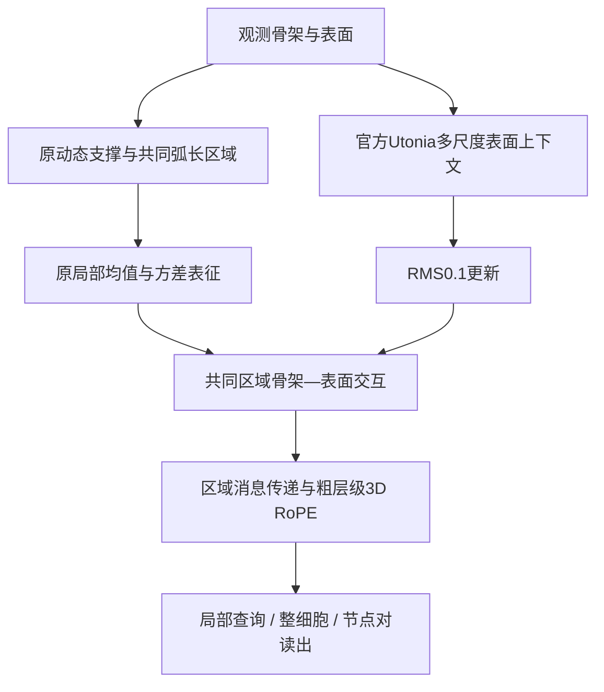

# CRSS: Common-Region Skeleton–Surface Encoding

神经元骨架—表面联合表征研究。**当前代码与实验更新为 R9（2026-10-17）**：保留共同区域主干，在原局部统计之后加入RMS0.1约束的官方Utonia多尺度上下文。五任务分别训练，不使用外部预训练权重。

**从 [START_HERE.md](START_HERE.md) 开始。**

| 内容 | 入口 |
|---|---|
| R9实际网络、输入与五任务读出 | [架构说明](docs/R9_ARCHITECTURE_ZH.md) |
| R9完成结果与三任务运行快照 | [结果表](docs/R9_RESULTS_ZH.md)、[机器可读结果](code/r9/RESULTS.json) |
| R9原代码、两项已训练权重与来源 | [R9代码包](code/r9/README.md) |
| 当前共享编码器 | [model.py](code/r9/reference/tools/cpsf_utonia_context/model.py) |
| FlyWire/TED/TLP适配 | [任务接口](code/r9/extension/tools/cpsf_r9_expansion/model.py)、[训练](code/r9/extension/tools/cpsf_r9_expansion/train.py) |
| 历史五任务完整模型与消融 | [历史代码说明](code/README.md)、[历史实验索引](docs/EXPERIMENTS_ZH.md) |
| 论文草稿与历史主线 | [论文主线](docs/PAPER_STORY_ZH.md)、[LaTeX](paper/main.tex)；尚未按R9结果改写 |

## R9结果边界

| 任务 | 固定最终轮开发集结果 |
|---|---:|
| H01局部 | Macro-F1 **0.667901** |
| H01整体 | MAE **0.0502774** |
| FlyWire六类 | 训练中，尚无R9最终结果 |
| TED | 训练中，尚无R9最终结果 |
| TLP | 训练中，尚无R9最终结果 |

三项扩展状态的具体采样时间见[结果页](docs/R9_RESULTS_ZH.md)。所有结果seed42、开发集；没有把旧模型成绩或测试成绩补入R9表格。R9的RMS0.3对照、同seed重放也完整保留，不能称已完成全部核心模块消融或五任务SOTA。



R9没有启用源码保留的GeoTransformer或Polynormer分支；没有学习式采样器或跨数据集共享训练权重。物理位置与尺度编码保留，具体输入及数值约定以[架构说明](docs/R9_ARCHITECTURE_ZH.md)为准。

## 校验与使用

```bash
python scripts/verify_r9.py
python scripts/verify_export.py
```

以上为标准库文件/版本核验。GPU推理和训练需要原CUDA依赖及相应输入；数据集、几何缓存与全部父运行目录未发布，不能把源代码归档等同于新机器的一键复现。详见[R9代码说明](code/r9/README.md)。

2026-10-11旧代码、权重、论文和冻结实验原样保留；其`code/model_full.py`不是R9入口。[原首页快照](docs/README_SNAPSHOT_20261011.md)可用于回溯。许可与来源见[RIGHTS_AND_PROVENANCE.md](RIGHTS_AND_PROVENANCE.md)。
