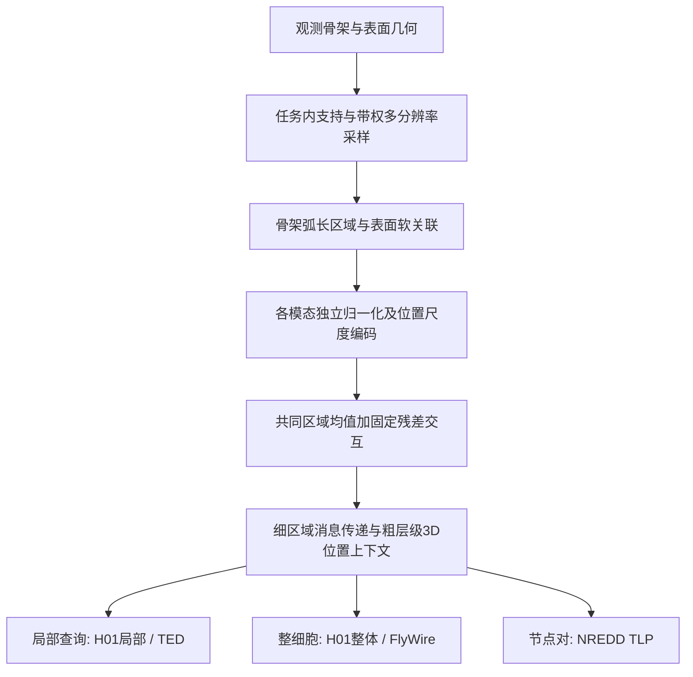

# CRSS: Common-Region Skeleton–Surface Encoding

神经元骨架—表面联合表征：当前完整模型、五任务冻结配置、实验依据与论文撰写材料。

**阅读入口：[START_HERE.md](START_HERE.md)。** 本仓库是 2026-10-11 的研究快照，便于作者和具备仓库读取权限的 GPT 对照代码理解论文。当前保留的是固定残差共同区域方案，**不是早期 V17 超图方案，也不是 V26 门控 full**。

| 要了解什么 | 从哪里读 |
|---|---|
| 论文要解决的问题、两个机制和论证顺序 | [论文主线](docs/PAPER_STORY_ZH.md) |
| 每项机制对应哪些类、数据构造和计算 | [代码导航](docs/CODE_MAP_ZH.md)、[完整模型](code/model_full.py) |
| 五任务、主结果、消融及最新基线边界 | [实验索引](docs/EXPERIMENTS_ZH.md) |
| 最新英文正文与中文逐段对应 | [LaTeX 主文件](paper/main.tex)、[中文对照](paper/notes/paragraphs_zh.md) |
| 当前论文 PDF | [manuscript.pdf](paper/manuscript.pdf) |
| 配置、权重与来源一致性 | [DEFAULTS.json](code/DEFAULTS.json)、[原代码包说明](code/README.md)、[来源映射](provenance/source_map.json) |
| 让 GPT 快速进入工作 | [可复制的阅读提示词](docs/GPT_READING_PROMPT_ZH.md) |

## 当前架构



统一的是表示设计和主干原则；五任务分别训练，并保留声明的任务适配。当前没有一套跨数据集通用的预训练权重。固定残差系数 0.1 是实现选择，不单列为创新。

## 运行完整模型

Python 3.10+，PyTorch 2.4+；详细输入字段及原环境见 [code/README.md](code/README.md)。

```bash
python -m pip install -r code/requirements-model.txt
python code/verify_package.py
python code/example.py --task h01_local
python code/example.py --task h01_global
python code/example.py --task flywire_coarse
python code/example.py --task ted
python code/example.py --task tlp
```

示例使用人工区域输入及五个原始检查点，只用于验证接口。`code/snapshots/` 保留完整构造、训练、评测和依赖源码。原训练入口依赖服务器数据路径、冻结父协议及 NREDD 上游项目；本仓库不包含原始数据集或全部几何缓存，不能等同于已在新环境完成全量复现。

## 证据与版本

- 主方法结果来自 2026-10-10 冻结审计，均为 seed 42 开发验证；不是独立测试集成绩。
- H01/FlyWire 固定残差；TED 默认 `lr_half`；TLP 默认 `directional_xyz`。三套快照分开保留。
- 2026-10-11 基线归一化复评独立记录：H01 保留完整模型领先；FlyWire 的 PointMamba 复评略高于完整模型，不能写全面领先。
- 英文稿来自 Overleaf 提交 `ac9fcd779b64ab82077a5aa5b9aca02f96f5f8e8`。已有摘要、引言、Related Work、Preliminaries、Method；实验章节和正式图表尚未完成。
- 不将残差、MLP、RoPE、标准消息传递声称为独立新发明；不声称尺度不变性或重采样不变性定理。

源码和论文以可搜索的文本展开；历史来源文件中的服务器绝对路径仅为溯源信息。许可证与第三方来源见 [RIGHTS_AND_PROVENANCE.md](RIGHTS_AND_PROVENANCE.md)。
