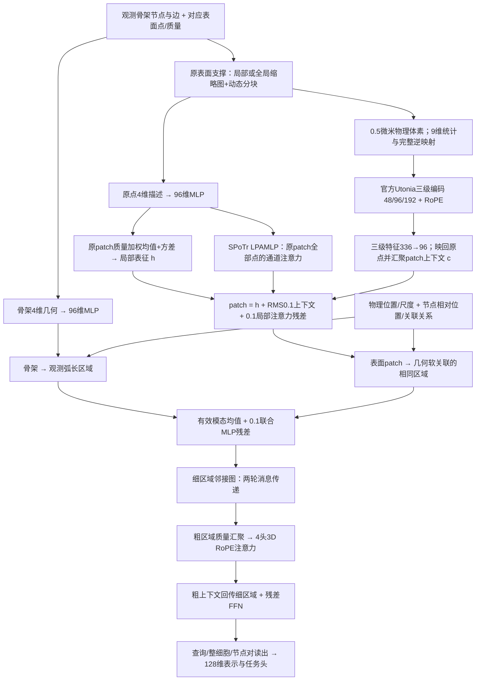

# R28：局部证据保护的多尺度骨架—表面共同区域编码

R28的实际组成是：**R9固定残差共同区域主干＋SPoTr官方局部通道注意力适配**。主配置在H01运行中称`r9_lpa_attention`，在三任务扩展中称`r28_lpa_attention`；二者是同一个R28模块机制。所有任务从零独立训练，不共享一套跨任务训练权重，不使用外部预训练。

它要处理的核心矛盾是：神经元表面局部细节、长程形态和骨架结构需要共同参与判别，但跨尺度压缩或上下文更新可能淹没局部证据。R28选择**先提取原局部统计，再补充原始点的可学习证据与受约束的多尺度上下文，最后在同一物理区域内融合骨架和表面**。

## 整体结构

主干特征维度96，最终读出128。实际源码入口是[H01模型](../code/r28/reference/tools/cpsf_raw_point_attention/model.py)和[三任务适配](../code/r28/extension/tools/cpsf_r28_expansion/model.py)。源码保留的GeoTransformer/Polynormer类没有在此配置启用；R28不包含R29–R33机制。

## 关键模块与每个模块最相关的一篇论文

**来源类型必须区分。**“直接代码来源”表示实际执行了该论文的官方组件；“设计启发”表示思路借鉴；“原理参照/相关对照”是解释自行实现模块最合适的文献，不表示历史上从其代码移植，也不构成新颖性证明。自行实现部分不能为满足引用数量而伪装成官方复现。

| 关键模块 | 在R28中解决什么、如何实现 | 最关键的一篇参考论文 | 来源类型与边界 |
|---|---|---|---|
| 跨尺度表面观测与动态分块 | 大细胞保留全局覆盖，分块补充局部支撑；局部与整体不强行相同点数 | **How Far Are We to GPT-4V? Closing the Gap to Commercial Multimodal Models with Open-Source Suites**，InternVL1.5，2024，[论文](https://arxiv.org/abs/2404.16821) | 动态分辨率tiling＋thumbnail的设计启发；3D采样/质量预算自行实现，不执行InternVL，也不是新学习式采样器 |
| 局部统计保护 | 点MLP后按原patch质量计算均值与方差，再映成96维，先于上下文注入 | **Deep Sets**，NeurIPS2017，[论文](https://arxiv.org/abs/1703.06114) | 置换不变集合汇聚的原理参照；加权二阶统计由项目实现，未复现Deep Sets整网 |
| 原始点通道注意力，R28的直接新增模块 | 在原patch全部点上，用相对XYZ和内容为不同通道选择证据 | **Self-Positioning Point-Based Transformer for Point Cloud Understanding**，SPoTr，CVPR2023，[论文](https://openaccess.thecvf.com/content/CVPR2023/html/Park_Self-Positioning_Point-Based_Transformer_for_Point_Cloud_Understanding_CVPR_2023_paper.html) | **直接代码来源**：官方LPAMLP、new_attention、特征组合和卷积工厂；仅局部模块，不包含SPoTr全局自定位分支 |
| 表面多尺度上下文及RMS0.1接口 | 同一观察点形成物理体素，官方层级编码映回原patch；限制上下文相对原局部表示的RMS幅度 | **Utonia: Toward One Encoder for All Point Clouds**，ICML2026，[论文](https://arxiv.org/abs/2603.03283) | **直接代码来源**：官方PointTransformerV3编码器/GridPooling/RoPE，缩小配置从零训练；物理输入和RMS接口自行实现，不等同复现官方感知粒度重定标或预训练 |
| 骨架—表面共同区域表示与交互 | 观察骨架弧长区域承载两路内容，几何软关联汇聚表面，然后均值＋0.1联合MLP | **Geometric Transformer for Fast and Robust Point Cloud Registration**，GeoTransformer，CVPR2022，[论文](https://openaccess.thecvf.com/content/CVPR2022/html/Qin_Geometric_Transformer_for_Fast_and_Robust_Point_Cloud_Registration_CVPR_2022_paper.html) | **相关对照文献，非直接来源**：局部几何组织与对应学习；R28自行实现异构共同支撑，**不执行GeoTransformer**，也不是其配准/交叉注意力模块 |
| 物理位置/尺度与旋转位置编码 | 内容侧显式保留物理位置、区域长度/支撑半径；粗区域Q/K采用3D轴向旋转编码 | **RoFormer: Enhanced Transformer with Rotary Position Embedding**，2021，[论文](https://arxiv.org/abs/2104.09864) | RoPE的技术参照，区域3D实现由项目编写；物理signed-log位置和尺度MLP为项目设计。Utonia内部另一处RoPE来自其官方代码 |
| 融合后区域结构与粗上下文 | 两轮邻接消息传递保留局部连接，粗区域注意力扩展上下文后回传细区域 | **Neural Message Passing for Quantum Chemistry**，MPNN，ICML2017，[论文](https://proceedings.mlr.press/v70/gilmer17a.html) | 消息/聚合/更新的原理参照；不是复制MPNN分子网络。粗注意力采用上一行RoPE，质量汇聚和固定残差自行实现 |
| 任务查询与整细胞读出 | 局部查询、全细胞质量池化、节点对对称组合共用96维区域流 | **Deep Sets**，NeurIPS2017，[论文](https://arxiv.org/abs/1703.06114) | 不变汇聚的原理参照；查询核、走廊上下文与监督头是项目任务适配 |

其中RMS0.1和零初始化输出是本项目的稳定接入口设计，没有独立复制的“官方RMS模块”；上表将它与所约束的Utonia上下文列在一起。固定0.1残差不保证训练后局部性能不会下降。

## 1. 输入与尺度

骨架节点为完整观测结构，四维节点特征包含度数、平均邻边长度的对数、端点和分叉点标志；节点本身先过MLP，连接关系通过弧长区域及区域邻接进入后续计算。不是一开始就有一个独立深层GNN。

点云保留原缓存的观察点、权重、patch成员与支撑；全局采样沿用缩略图和动态分块，局部沿用局部观察。Utonia输入采用0.5微米体素，四维原点描述的质量加权均值/方差和log质量形成9维输入，完整逆索引使每个观察点都能获得上下文。

这并不代表所有数据原始采样预算相同。R28保留动态分辨率，但并未新增学习式点选择或证明任意尺度不变性。

## 2. 三路patch证据，先局部后上下文

令点特征为x_i，原点质量为w_i：

`mu_p = sum(w_i x_i)/sum(w_i)`

`h_p = MLP([mu_p, sum(w_i x_i²)/sum(w_i) - mu_p²])`

官方SPoTr局部模块使用全部原patch点，按通道计算：

`a_ic = softmax_i(attn([relative_xyz_i, x_i])_c + log(w_i))`

padding以负无穷logit屏蔽，随后是官方值变换、残差、激活和FFN；不能把它简化成只有一层softmax。query使用原mu_p，分组适配取代ballquery，不引入FPS或外部点。单点patch的新注意力残差严格为0。

Utonia三级通道48/96/192、深度1/1/2、头数2/4/8、窗口128；三级特征通过官方pooling inverse拼接为336维，投影96维、映回原点，按原质量汇聚成c_p。两路校正为：

`P_p = h_p + 0.1 * stopgrad(RMS(h_p)) * c_p/max(RMS(c_p),1e-6) + 0.1 * W_out(LPAMLP_p - mu_p)`

RMS按patch逐个计算。W_out是96→96无偏置、零初始化线性层，因此初始化时R28精确回到R9；不加载R9训练权重。

## 3. 神经元物理关联与编码

骨架节点按节点—区域的弧长质量汇聚，叠加节点相对区域中心的位置MLP。表面patch根据到观察骨架折线的距离和沿弧长位置等建立软关联；关系特征phi为归一化距离/平方、沿弧长位置/平方及长度半径比对数，由MLP编码后随表面质量汇聚。

两路区域内容加入同一物理编码：中心化坐标的signed-log变换经位置MLP，加上`log1p(区域长度、支撑半径、0.5微米基础分辨率)`经尺度MLP。**基础分辨率一项当前固定为0.5，并非每个tile的分辨率都动态进入尺度MLP。** 不应将其泛称为已完成的任意分辨率位置编码创新。

骨架弧长质量与表面质量分别归一，再合成区域读出质量；不把长度与面积直接相加。缺少其中一种模态时，仅使用有效模态；只有两路都存在时启用联合残差：

`z_r = mean_valid(g_r, p_r) + 0.1 * MLP([g_r,p_r])`

实际融合是几何关联汇聚＋MLP，不是骨架查询点云的交叉注意力，也不是新超图Transformer。共同区域可以用关联/超边语言解释，但不能因此声称已经实现新的超图算子。

## 4. 两级区域上下文与物理RoPE

细区域邻接图进行两轮消息传递，message输入为两端96维内容、相对XYZ和距离；均值聚合后以0.1残差更新。区域按既有coarse_owner作质量汇聚，粗区域中心物理坐标减均值后除8，Q/K分为4头，对XYZ分别应用轴向RoPE，注意力输出回传细区域，最后0.1残差FFN。

R28有两处RoPE：官方Utonia点层级内部的RoPE，以及项目自写的粗区域3D RoPE。二者不应合并描述成同一个新模块。位置、尺度、动态分辨率的R28专属完整贡献矩阵尚未补齐，旧版本消融不能替代。

## 5. 五任务读出

| 任务 | 输入粒度与读出 | 主指标 |
|---|---|---|
| H01局部 | 查询周围4微米区域，按距离和质量池化；三类分类 | Macro-F1 |
| H01整体 | 整细胞质量池化，sigmoid比例回归 | MAE |
| FlyWire粗类 | 整细胞质量池化；六super_class分类 | Macro-F1；**不是检索** |
| TED | 指定骨架节点周围区域查询，二logit[-s,s] | 正类F1 |
| TLP | 每节点查询＋节点对走廊/整图上下文；对称组合a+b、abs(a-b)、context | 全部未观察无序节点对的Missing-edge Macro-AP |

TLP内容保留方向XYZ描述，SPoTr几何仍用原patch相对XYZ，不从方向描述还原物理坐标。监督目标和observed掩码保留在损失/评测接口。评测镜像未用的下三角，保留原FP32 i<j评分，不平均双向分数。

## 直接代码来源与结论边界

- **Utonia**：`da776a0bd3a48c6df83ac2ae0e27b26141cc7e31`；官方Apache-2.0许可证原样保留。
- **SPoTr**：`69ea023d3781372df80e23326ef56b58a9b60cd6`；官方MIT许可证原样保留；实际调用与质量/padding适配见[official.py](../code/r28/reference/tools/cpsf_raw_point_attention/official.py)。
- RoFormer是自写区域RoPE的技术参考；R28没有下载或运行一个“官方RoFormer全网”。
- InternVL1.5、Deep Sets、GeoTransformer和MPNN是设计启发/原理或相关对照，不是全部直接代码依赖。GeoTransformer历史源码虽保留，主配置未启用。

R28通道注意力在H01两项均优于其uniform对照，但相对R9仍是整体改善、局部略降。它是用户选定的后续参照，不应写作已全面超越R9或五任务SOTA。当前最完整的证据见[结果与基线表](R28_RESULTS_ZH.md)。
