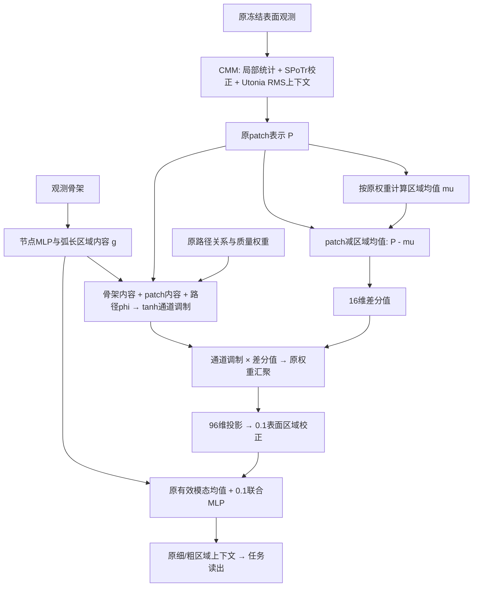

# R34：骨架与路径条件的区域差分消息

本页描述已实现、训练并发布的 **R34阶段一**，冻结版本 `CPSF_PATH_MESSAGE_20261020_R34_A2`。它继承R28，只改变RCM中表面patch进入骨架区域的消息；没有启用后续层级贡献接口或SPoTr内部差分值改造。

## 问题与实际改动

R28先把关联patch汇聚为区域表面描述，再与骨架内容融合。即使保留了几何软关联，这种先汇总的方式仍可能弱化“当前骨架路径需要哪一种局部表面差异”。R34检验：在汇总前，是否应让骨架内容、patch内容与路径关系共同决定每个patch的通道消息。

原关联集合、权重与区域表面均值均保留。新增项只在原region–patch边上计算，不新建对应、不删除表面，也不估计对应置信度。



## 精确计算

区域r、关联patch j的归一化权重为 `a_rj = pw_rj * patch_mass_j / surface_mass_r`。首先计算 `mu_r = sum_j a_rj P_j`。

```text
q_r = Wq(LayerNorm(g_r) + c)
k_j = Wk(LayerNorm(P_j))
t_rj = tanh(q_r + k_j + MLP(phi_rj))
v_rj = Wv(P_j - mu_r)
delta_r = Wout sum_j a_rj (t_rj * v_rj)
surface_r = original_surface_r + 0.1 * matched_r * delta_r
```

主干96维，低秩通道16维；c为可学习96维常量。完整候选新增6,608参数。Wout零初始化，仅保证初始新增输出为零，不保证训练后的性能不下降。实际实现见 [PathMessage及Model.stems](../code/r34/overlay/tools/cpsf_path_message/model.py)。

新增消息使用尚未加入共享全局位置/尺度偏移的骨架区域内容；delta加到原表面stem之后、原joint之前。原关系编码、物理位置/尺度、区域传播和读出保持。t是有符号的通道调制，不是概率或可靠性；原mass也不是置信度。

计算按原对应顺序分块并使用checkpoint控制显存，不截断关联。常值patch、单patch支持时中心化差分为零；缺失模态时新增消息被屏蔽。并非所有区域都能从此新增项获得信息。

## 两个机制对照

- `constant_message`：以同一个可学习常量替代新增消息中的观测骨架内容，保留相同参数量和初始化。原骨架分支、区域、路径phi与joint都仍存在，不能称为无骨架模型。
- `ordinary_attention`：R17式四头条件注意力，带mass与几何logit，基于官方GeoTransformer vanilla attention适配。新增37,281参数，不是等容量对照，也不是完整GeoTransformer网络复现。

## 与R28及新输入工作的关系

R28的局部统计、SPoTr官方LPAMLP、Utonia官方三级编码/RoPE、RMS0.1接入口、物理位置/尺度和后续两级区域传播均保留。[R28架构说明](R28_ARCHITECTURE_ZH.md)提供继承部分的逐模块来源。

本次R34成绩使用**原R28的冻结H01输入**，保留当时的采样及质量构造；没有切换到独立几何预算＋一次全源FPS。新的研究路线已将观测获取降为普通预处理，但这不允许改写本版本的输入身份。两条输入协议必须分别验证、分别报告。

R34的路径条件差分是项目自行实现的门控消息适配，不宣称新的注意力理论、动态超图算子或已证实的对应纠错。直接官方组件仍须注明Utonia与SPoTr；仅普通注意力对照执行GeoTransformer衍生算子。阶段二/三设计不属于本发布。
