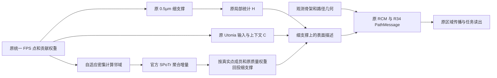

# R34：扩大计算邻域，保留细粒度证据支撑

本发布对应 `CPSF_R34_AP10_SUPPORT_PRESERVED_20261023_A1`，使用统一 FPS 输入。它与此前旧输入的 R34 阶段一、直接扩大 patch 的 AP10 均为独立版本。

## 计算流程与原 R34 的差异

原 R34 将 SPoTr 计算邻域与细支撑绑定为 0.5µm。完整神经元上细支撑常只有少数采样点。直接扩大所有 patch 会同时改变局部统计、表面与骨架关联、区域表示以及上下文输入，AP10 的 H01 整体结果明显下降。

本版只扩大 SPoTr 的计算邻域：从 0.5µm 开始按 2 倍增长，取第一个满足 `N / J(h) >= 10` 的窗口；同一规则不依赖任务标签。**这是平均密度规则，不保证每组至少 10 点。** 无新增 FPS 点，无额外原始数据缓存。

设点 i 原本属于细支撑 f(i)，扩大后属于计算邻域 d(i)，贡献权重为 w_i。密集 SPoTr 输出增量 D 后，回投为：

\[
\widetilde D_f=\frac{\sum_{i:f(i)=f}w_iD_{d(i)}}{\sum_{i:f(i)=f}w_i}.
\]

R34 表面描述继续使用原局部基底、原 RMS0.1 Utonia 增量以及 `0.1 ×` 回投增量。区域关联、PathMessage、后续传播和读出保持原形式，参数数量、初始化及训练设置不变。相对坐标仍以 0.5µm 为物理单位；细支撑尺度编码仍表示真实的 0.5µm 支撑，不把计算窗口宽度冒充支撑尺度。

共同密集邻域可能向多个细支撑回传同一个增量；这些细支撑各自的局部基底与骨架关联仍保留。本版没有实现细查询条件化上下文，也不宣称具备 AP10 压缩区域数量的计算节省。

## 模块来源与贡献边界

| 部分 | 实际来源 | 本版变化 |
|---|---|---|
| Utonia 上下文 | 官方 Utonia（ICML 2026）及项目已有适配 | 输入、结构、梯度训练方式不变 |
| 原点通道聚合 | 官方 SPoTr（CVPR 2024）LPAMLP 与项目已有质量权重接口 | 只改变计算邻域，回投到原细支撑 |
| 骨架—表面共同区域 | 项目原 R28/R34 实现 | 保留原关联、质量和物理编码 |
| 路径条件差分消息 | 项目 R34 PathMessage | 保持原计算 |
| 邻域与支撑分离 | 本次项目修改 | 增量按真实点成员与权重回投 |

官方模块和许可证原样保留。本版的可归因改动是计算邻域与证据支撑解耦，不把官方主干改名为原创，也不把表面采样作为核心创新。

## 已完成的匹配比较

H01 整体：80 训练/24 开发，seed42，50 轮/1000 更新，AdamW 3e-4，固定最终轮，无外部预训练。不同版本独立从零训练。

| 版本 | MAE↓ | RMSE↓ | R²↑ |
|---|---:|---:|---:|
| R34 统一 FPS | 0.051537 | 0.067523 | 0.720127 |
| 直接 AP10 | 0.079138 | 0.098639 | 0.402750 |
| AP10＋恢复原 Utonia 输入 | 0.079215 | 0.098746 | 0.401455 |
| **本版：密集邻域＋原细支撑** | **0.050024** | **0.066907** | **0.725206** |

完整精度、所有候选与外部基线见[统一 FPS 汇总](UNIFIED_FPS_RESULTS_20261023.md)及其机器可读证据。相对原 R34，MAE 下降约 2.94%；这支持此任务上的修改，不等同于跨任务泛化已经成立。

H01 局部：716 训练和 214 开发样本在原 0.5µm 下均已满足平均≥10 点；最小平均值分别为 11.0635 和 12.5427，因此规则均不触发。两例原局部权重前向结果完全一致，但**没有本版正式局部重训或全开发集复评成绩**。FlyWire 等其他任务也没有本版完成成绩。

## 发布与复现范围

[代码包](../code/r34_dense/README.md)包含冻结源码映射、最终权重、预测、协议和验收。发布校验会核对组装代码来源、模型构造、严格权重加载和保存预测的指标复算；不宣称已在新机器重新完成训练。原始神经元数据、几何缓存、父运行目录与二进制依赖不分发。
