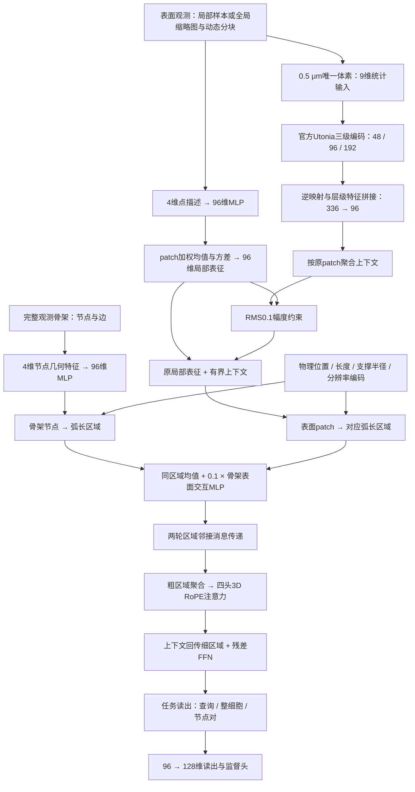

# R9 实际网络架构与三任务扩展

R9 是 `CPSF_UTONIA_KERNEL_LOCK_20261016_R9_A1` 的 `patch_rms_010`。本文件以实际调用的代码为依据。它保留固定残差的共同区域编码器，在**原局部统计完成之后**接入 RMS0.1 约束的官方 Utonia 上下文。不是 R18/R19，也没有启用源码中保留的 GeoTransformer 或 Polynormer 分支。

本次只扩展 FlyWire 粗类、TED、TLP 的训练验证。新运行目录 `CPSF_R9_TASK_EXPANSION_20261017_A2`，共享主干源文件与 R9 逐字节核对，另加任务适配包。三个任务独立从随机初始化训练，不加载 H01 权重或外部预训练权重。

## 网络图

## 1. 输入与尺度组织

骨架保留完整的观测节点与边；节点四维特征为度数、平均邻边长度的对数，以及是否端点、是否分叉点。区域由观测骨架沿弧长分段构造，并保留孤立节点与无骨架支持的表面patch。

全局样本沿用已有的缩略图＋动态分块表面观测及质量权重；局部样本沿用原局部观测。各数据集原始采样缓存有各自的预算，并不强行设置相同点数。R9 本身没有额外训练一个学习式采样器：它在保留的观测支撑上，统一增加0.5 μm体素化及Utonia层级汇聚。

骨架—表面的关联由观测几何构造：patch到骨架折线的距离、沿弧长的位置等决定软关联；多个区域共享同一patch的质量时作归一化。不使用真实缺失边或任务标签构造区域。

## 2. 局部表征与官方上下文

点的四维描述先经MLP变为96维，在每个patch内部计算质量加权均值和方差，拼接为192维，再经MLP得到96维局部表征 `h`。

另一路将相同点集按0.5 μm物理体素汇聚：四维描述的均值、方差及log质量组成9维输入。官方Utonia使用三级48/96/192通道、深度1/1/2、注意力头2/4/8、窗口128，保留官方GridPooling与RoPE；按原逆索引把三级特征拼接为336维，投影成96维并映回每个观测点，再按原patch汇聚为上下文 `c`。

加入原局部特征的更新为：

`h_new = h + 0.1 × stopgrad(RMS(h)) × c / max(RMS(c), 1e-6)`

计算按patch逐个执行。原局部均值/方差在接入上下文前已完成；约束的是新增上下文的相对RMS幅度，不是把原局部表征归一化掉。这不保证训练后原参数或局部准确率保持不变。

这是官方Utonia模块的缩小配置适配，使用真实官方源码，非完整默认Utonia模型复现。来源commit：`da776a0bd3a48c6df83ac2ae0e27b26141cc7e31`；没有外部预训练。

## 3. 骨架—表面共同区域交互

骨架特征按照节点—弧长区域关联汇聚，并加入节点相对区域中心的位置编码。表面patch按照几何软关联与质量汇聚，并加入五维关系描述：归一化距离及其平方、沿弧长位置及其平方、区域长度与半径比的对数。

两路都加入同一物理位置与尺度编码。位置使用中心化坐标的带符号log变换；尺度显式包含区域长度、支撑半径、0.5 μm基础分辨率。

同一细区域先对有效模态取均值，再叠加 `0.1 × MLP([骨架; 表面])`。只有两种模态都存在的区域才计算交互残差。这里的关联可以解释为共同区域关联结构，但**实际跨模态融合是关联汇聚＋MLP，不是双流交叉注意力或新的超图Transformer**。

骨架弧长质量和表面质量分别归一化后，才合成区域读出权重；不直接把不同物理单位相加。

## 4. 局部结构与大范围上下文

共同区域流先在区域邻接图上进行两轮消息传递，消息包含两端96维内容、三维相对位移和距离。然后按已有粗区域分组作质量加权汇聚，在粗区域上执行四头3D RoPE自注意力，再把上下文回传细区域，最后执行残差FFN。消息、粗上下文和FFN均采用固定0.1残差。

因此R9有两处上下文：**Utonia的表面多尺度上下文**，以及**融合后区域图上的粗尺度上下文**。骨架最前端是节点MLP，图结构主要通过弧长区域与后续消息传递进入计算。

## 5. 五任务接口

| 任务 | 读出 | 输出／主指标 |
|---|---|---|
| H01局部 | 查询周围4 μm区域的距离和质量加权池化 | 三类分类；Macro-F1 |
| H01整体 | 整细胞质量加权池化 | Sigmoid比例回归；MAE |
| FlyWire粗类 | 整细胞质量加权池化 | 六类分类；Macro-F1 |
| TED | 待判定节点周围区域查询读出 | 对称二logit `[-s,s]`；正类F1 |
| TLP | 每节点查询读出＋节点对走廊及整图上下文；对称组合 `a+b, abs(a-b), context` | 全部未观察无序节点对评分；Missing-edge Macro-AP |

TLP沿用已确定的方向XYZ局部描述与确定性走廊汇聚。真实坐标必须从原voxel相对坐标与patch中心还原，不能从方向XYZ描述还原。其监督矩阵、观测边掩码留在损失／评测接口，模型输入不含目标边。节点对走廊覆盖全部节点对，不用候选筛选提高主指标。

## 6. 本轮固定预算

| 任务 | 训练／开发样本 | 轮数 | 优化器更新数 | 配置 |
|---|---:|---:|---:|---|
| FlyWire粗类 | 6,039／1,922 | 50 | 62,200 | 每轮4,975训练细胞；batch4；AdamW 3e-4，cosine到3e-5 |
| TED | 23,967／10,762事件 | 30 | 11,250 | 64事件累积求和；Adam 5e-4，1/(epoch+1) |
| TLP | 156／62图 | 80 | 12,480 | batch1；Adam 1e-3，StepLR20×0.1 |

固定seed42、原划分、原最终轮，不选择最优epoch；本轮只做开发集验证，不使用测试集反馈。已有开发集被历史迭代使用过，不能称盲测。新版本不引入R18/R19、GeoTransformer、Polynormer或额外损失。

H01既有参考：局部Macro-F1=0.6679012346，整体MAE=0.0502774163。其他三项在完成前不填写成绩；共享架构不等于共享五任务训练权重。

正式验收、启动状态与资源快照在完成后追加。

## 正式启动与验收（2026-10-17 08:58，北京时间）

正式版本 `CPSF_R9_TASK_EXPANSION_20261017_A2`，协议SHA256 `02e2464ac61a748da4930b809755e6f94c4d945dba52d022a7061c6d96a603bd`。

继承的499个源文件哈希与R9一致。FlyWire旧缓存中85个样本需要应用R9原有的最少粗分组修复；只修改coarse_owner分组，不修改细区域、观测点或标签。准备阶段A1未训练，修复后另冻结A2；小型坐标sidecar在A1目录保留并按哈希引用，不重复复制原数据。

输入侧文件对原joint与point缓存逐项核对pf、point_owner、point_weight、patch_mass与origin，完整保留原观测坐标。TED直接复用既有已核验manifest和坐标sidecar。所有训练／开发细胞或空间组不相交；TED/TLP逐key和group与外部基线划分相同。只读原数据，未访问测试集进行选型。

验收：FlyWire11例、TED7例、TLP6例真实训练样本，覆盖最小、中间、节点数／区域数／patch数／点数／关联数各最大样本，TLP另含最大query与走廊关联。旧核心初始参数相同；关闭新增Utonia后与原任务核心输出最大差不超过1.5e-8。全部实际前反向有限，骨架、点云、交互、位置、尺度、处理器和官方Utonia有非零梯度，TLP输出对称。每任务独立两GPU的两步真实优化loss与参数哈希完全一致；这是工程重放检查，不是多seed效果实验。

| 任务 | GPU | 训练PID | 实读进度 | 参数量 | 验收峰值显存 |
|---|---:|---:|---|---:|---:|
| FlyWire粗类 | 0 | 937074 | 1/50轮，11更新，44/4975样本 | 3,731,990 | 6.50 GiB |
| TED | 1 | 937076 | 1/30轮，1更新，64/23967事件 | 3,731,345 | 0.10 GiB |
| TLP | 1 | 937077 | 1/80轮，71更新，71/156图 | 3,780,625 | 2.89 GiB |

三项均核对真实进程CWD、参数、身份与冻结哈希，无failure。正式显存快照GPU0约2.10GiB，GPU1约3.74GiB；显存随样本增长。数据盘约76GiB可用。后台调度器只管理这三项，小时自动化仍暂停。当前没有三项最终成绩，训练结束后各自评估固定最终轮开发集；不触发架构自动迭代。

证据：`artifacts/CPSF_R9_TASK_EXPANSION_20261017_A2/{protocol,contracts,preparation,launch,live_snapshot}.json`及`acceptance/`；本地任务适配代码为`tools/cpsf_r9_expansion/`。运行中源代码冻结；后续发现问题需另建版本，不改写现有运行身份。
