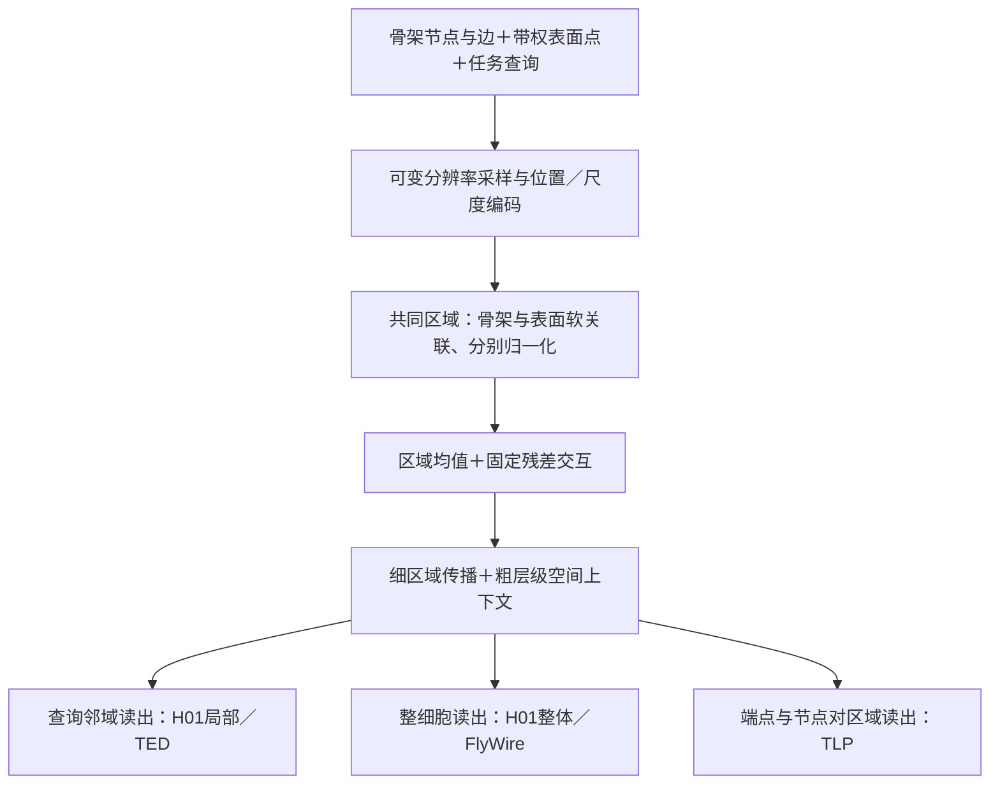

# 三个数据集、五个任务：当前默认结果与方法体系

服务器核验时间：2026-10-10T14:51:48.757345+08:00。47项当前默认方案结果、30项配置探索记录已对照原始文件；共核验三个实验根目录538项源码哈希（包含继承副本，非538个独立模块），同时核对参考运行、协议和最终权重。全部为seed42开发验证结果。

本文使用当前各任务默认配置：H01/FlyWire为固定残差clean core；TED为学习率减半；TLP为方向XYZ＋原训练配置。每列内部使用匹配版本与预算；五任务尚不是同一个最新实现、同一套权重的联合训练发布。

## 1. 任务究竟是什么

| 数据集／任务 | 输入范围与预测对象 | 监督标签／输出 | 训练／验证规模 | 主指标 |
|---|---|---|---|---|
| H01局部 | 查询位置附近的骨架＋表面局部形态 | AIS／axon／dendrite三分类 | 716／214事件，按细胞划分 | Macro-F1↑ |
| H01整体 | 整细胞骨架＋表面形态 | 兴奋性输入比例回归 | 80／24细胞 | MAE↓ |
| FlyWire整体 | 整细胞骨架＋表面形态 | 六个super_class粗类别 | 6039／1922细胞 | Macro-F1↑ |
| NREDD TED | 以待判断骨架节点为中心的局部事件 | 重建错误节点二分类；对应误连检测／切断定位 | 23967／10762事件，151／50空间块 | 正类F1↑ |
| NREDD TLP | 观测骨架图＋表面形态，逐节点对查询 | 未观测节点对是否应连边 | 156／62图 | Missing-edge macro AP↑ |

FlyWire六类为ascending、central、optic、sensory、visual_centrifugal、visual_projection；当前保留主实验为粗分类。之前的细cell_type分类和检索属于历史实验，尚未形成当前固定残差方案的对应完整消融表。TLP是图尺度编码、节点对输出，不是整细胞单标签分类；H01整体是形态预测功能相关比例，不是几何尺寸回归。

H01局部25轮、整体50轮；FlyWire50轮、每轮4975样本预算（从6039训练池中取样）；TED30轮、lr0.0005；TLP80轮、lr0.001和每20轮乘0.1。H01 full取自V26目录的fixed_residual对照，不是门控full。H01/NREDD采用minimum-four层级修复；FlyWire保留其冻结V23层级。

## 2. 当前完整模型和关键对照

除MAE外均为百分数。†NREDD表面分支保留骨架查询位置和既定样本支持，作为辅助诊断，不作为完全脱离骨架的独立任务。

| 配置 | H01局部 F1↑ | H01整体 MAE↓ | FlyWire粗类 F1↑ | TED F1↑ | TLP缺边AP↑ |
|---|---:|---:|---:|---:|---:|
| 完整模型 | 65.911 | 0.05105 | 84.916 | 49.552 | 58.365 |
| mean_only | 63.996 | 0.05170 | 76.021 | 49.520 | 57.241 |
| no_fusion | 61.625 | 0.05634 | 76.126 | 48.852 | 55.206 |
| 骨架分支 | 54.837 | 0.06483 | 76.380 | 46.933 | 55.979 |
| 表面点云分支† | 57.660 | 0.08971 | 72.545 | 36.416 | 26.878 |
| 去尺度编码 | 60.752 | 0.06390 | 75.141 | 48.708 | 56.816 |

mean_only在共同区域内作模态平均并保留后续主干；no_fusion将两路分别处理后汇合；两者不是同一个对照。TLP骨架参考在阶段6重跑并精确恢复阶段4损失、权重、预测及分数，点描述对其无效。

按当前共同默认配置，五个任务full高于上表已完成对照。相对mean_only：H01局部+1.915个百分点，H01整体MAE降低0.000653，FlyWire+8.895个百分点，TED+0.032个百分点，TLP+1.124个百分点。H01整体和TED的该项优势较小。

TED的配置探索必须同时保留：延缓衰减时骨架F1为53.415%，超过其同配置full49.380%，也超过所选默认full49.552%。因此当前结论是“指定共同配置下full领先”，而非“各模型获得等搜索机会后full仍最优”。该探索仍有3项运行；默认lr_half七项已齐。

## 3. 位置、尺度、分辨率、对应与上下文

| 配置 | H01局部 F1↑ | H01整体 MAE↓ | FlyWire粗类 F1↑ | TED F1↑ | TLP缺边AP↑ |
|---|---:|---:|---:|---:|---:|
| 完整模型 | 65.911 | 0.05105 | 84.916 | 49.552 | 58.365 |
| 去位置编码 | 62.596 | 0.06430 | 67.681 | 48.170 | 待补 |
| 去尺度编码 | 60.752 | 0.06390 | 75.141 | 48.708 | 56.816 |
| 位置、尺度均去掉 | 65.472 | 0.05684 | 73.315 | 待补 | 待补 |
| 仅全局缩略采样 | 未设 | 0.08095 | 73.071 | 未设 | 待补 |
| 同点数预算均匀采样 | 未设 | 0.05326 | 75.010 | 未设 | 待补 |
| 同样本区域内容错配 | 60.204 | 0.05454 | 74.109 | 待补 | 待补 |
| 去粗层级上下文 | 63.025 | 0.07711 | 81.223 | 待补 | 待补 |

“待补”严格指当前默认版本／配置没有对应结果。TED旧lr0.001的no_position_scale、shuffle_regions、no_context不能填入lr0.0005列。TLP旧描述、旧读出或旧训练目标的结果不能填入方向XYZ列。“未设”表示当前局部任务不设置整细胞采样对照。

已有较完整证据：

- 同点数预算下，动态分块相对均匀采样使H01整体MAE降低约4.15%，FlyWire Macro-F1增加9.91个百分点。说明收益涉及点预算的空间分配，不能仅归因为点更多。
- 错配区域表面内容后，H01局部下降5.71个百分点、FlyWire下降10.81个百分点；支持真实空间对应的价值。该对照同时改变区域内容分配，不仅改变交互MLP。
- 去粗上下文，H01整体MAE由0.05105升到0.07711，FlyWire Macro-F1由84.916%降到81.223%；支持区域间上下文路径。
- H01位置和尺度存在非加性：两者同时去掉的局部F1为65.472%，高于单独去掉任一项，但低于full65.911%。不能写成两模块独立、单调叠加贡献。
- no_position仍保留几何构造、关联和查询；no_scale只移除显式尺度MLP；no_context保留细传播及最终池化。应按实际删除的计算路径解释。

## 4. TLP方向描述的直接证据

| 描述方案（原训练配置） | full缺边AP（%） | 表面分支辅助诊断AP（%） |
|---|---:|---:|
| 原voxel描述 | 55.799 | 22.284 |
| 真实邻域XYZ＋原第四维（当前默认） | 58.365 | 26.878 |
| 真实邻域XYZ＋新位移范数 | 57.976 | 25.217 |

当前默认只替换前三维为真实邻域相对坐标，保留原第四维范数；原坐标轴不旋转到PCA主轴，稀疏／退化邻域回退原描述。full比原描述增加2.566个百分点，比骨架55.979%高2.386个百分点。这个改动已在TLP验证，尚不能写为所有数据集的共同输入升级。

## 5. 总问题和三层问题体系

建议总问题：**如何在局部到整细胞的形态尺度跨度下，将离散骨架拓扑与稠密表面几何组织为具有空间对应关系的联合表征，并支持节点、节点对和整细胞层面的预测？**

这包含三个递进问题：

1. **输入可见性与尺度语义。** 固定点数对大细胞可能覆盖不足，小局部则可能描述冗余；逐样本尺度归一化还可能抹去长度与分辨率语义。先解决“看到了哪些形态、这些坐标和尺度代表什么”。
2. **异质模态的对应与协同。** 骨架节点/边与表面点密度、组织方式及测度不同，全局各自池化会丢失局部对应。再解决“哪部分骨架应与哪部分表面交换证据”。
3. **局部证据如何形成任务所需上下文。** 节点判断、连边判断与整细胞分类/回归需要不同范围的证据。最后解决“共同区域证据如何跨区域传播并按查询聚合”。

任务对应：H01局部验证细局部区室语义；TED验证重建拓扑异常；H01整体验证形态与输入组成关系；FlyWire验证长尾粗类别；TLP验证观测结构上的连接补全。五任务提供不同监督，不要求人为把每个数据集都切成完全相同的局部/整体二分类形式。

## 6. 保持聚焦的创新体系

| 层次 | 机制及实际变化 | 对应证据 | 当前定位 |
|---|---|---|---|
| 输入层：可变分辨率与物理位置/尺度表征 | 全局缩略＋可变数量局部块，带权点预算；骨架/点云使用共同坐标约定，显式编码区域位置、相对位置、段长度与分辨率；粗上下文使用3D位置编码 | H01/FlyWire同预算采样、no_position/no_scale/双去掉 | 第一项核心机制 |
| 交互层：共同区域上的双模态关联 | 骨架和表面映射到共同区域，各自质量归一化；基础均值保留模态证据，再加固定0.1残差交互 | 单分支、mean_only、no_fusion、区域错配 | 第二项核心机制 |
| 表征层：局部到整体的层级区域主干 | 稀疏邻接传播＋粗层级空间上下文；节点查询、节点对查询、整细胞加权读出 | H01/FlyWire no_context，五任务适配结果 | 连接前两项的第三层方法组织；独立新颖性尚需论证 |

建议论文贡献写为**两项核心机制＋统一的多尺度多任务验证体系**。若希望写成三条贡献，第三条可以呈现层级区域表征如何支持三种输出粒度，但不应仅把标准池化、注意力或任务头本身称作独立创新。

共同区域融合的核心形式为：

\[
b_u=\frac{g_u+p_u}{\max(1,m_u^g+m_u^p)},\qquad
h_u=b_u+0.1\,m_u^g m_u^p\,F_\theta([g_u,p_u]).
\]

其中缺失模态置零，m为有效掩码；骨架弧长质量与表面点/面积质量分别归一化。每个区域可解释为连接多个骨架节点和表面patch的软超边；当前实际算子是关联聚合、区域残差和区域图传播。关于“高阶超图”的强主张仍需算子对应和独立对照支持。

统一的是输入字段、对应原则和主干计算结构；各任务分别训练。局部样本沿用局部裁剪，整细胞按大小增加块数，不能为形式统一强制所有样本使用相同点数。查询只决定读出目标，标签在监督侧。

当前使用固定几何关联半径，因此较准确的名称是“可变分辨率、尺度感知”，而不是已证明任意尺度关联自适应或尺度不变。H01/FlyWire具有物理单位约定，NREDD仍有原始坐标标定限制；不能声称三个数据集均完成微米级统一。现有分任务监督训练也不能推出共享权重的零样本迁移。

## 7. 哪些属于实现修复或任务适配

骨架输入修复、minimum-four层级防退化、确定性聚合是正确性与可复核性的基础；TED学习率选择是训练配置；TLP方向XYZ与节点对区域读出是当前任务适配。这些可以解释结果、写入方法细节，但当前证据不足以把它们都扩张成跨数据集的独立创新点。

当前证据强度：H01/FlyWire三任务具有完整度较高的模块证据；TLP已具备方向描述与核心交互/尺度对照，位置/分辨率/上下文尚待补；TED默认配置有正向排序，但交互相对均值优势小、对训练配置敏感。优势仅针对各任务预设主指标，不保证所有次指标、类别都领先。

## 8. 下一步最有价值的补齐

1. TED在默认lr_half下补no_position_scale、shuffle_regions、no_context；TLP在方向XYZ下补no_position、no_position_scale、thumbnail、uniform_budget、shuffle_regions、no_context。旧结果继续保留。
2. 固定共享编码器的模块定义与任务适配边界，尤其FlyWire层级差异、NREDD坐标单位、TLP独有输入描述与读出；之后再决定是否需要五任务统一新版本重训。
3. 对最终两项核心机制做针对性相关工作比较，以具体算子和证据说明贡献增量；本次整理不把新颖性候选写成已获文献认证的“首创”。

这些是本次整理提出的补齐优先级，尚未启动新训练。当前剩余3组配置探索正常继续。

## 证据与实现

- [当前47项结果及版本核验](artifacts/CPSF_CURRENT_FIVE_TASK_20261010/results_audit.json)
- [核验脚本](artifacts/CPSF_CURRENT_FIVE_TASK_20261010/audit.py)
- [TED默认配置](CPSF_TED_DEFAULT_DECISION_20261010.md)、[TLP默认方案](CPSF_TLP_DEFAULT_DECISION_20261009.md)
- [区域固定残差主干](tools/cpsf_fixed_core/model.py)、[位置/尺度编码](tools/cpsf_v23_scale_ablation/model.py)
- [TLP方向XYZ适配](tools/cpsf_directional/model.py)、[真实邻域描述](tools/cpsf_directional/descriptor.py)、[节点对读出](tools/cpsf_pair_region/model.py)

分组、缓存、检查点和测试隔离沿用冻结协议；既有划分与重复检查不等价于证明所有同源/近重复风险已排除。全部数字是当前开发验证成绩。
