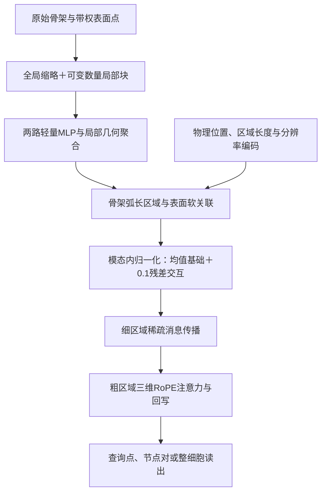

# 当前方法的基础架构、核心机制与论文阅读指南

整理日期：2026-10-11。依据当前固定残差clean core代码、10月10日五任务方法梳理、历史设计记录，以及本次重新访问的论文官方页面。本文整理来源关系，不新增训练或更改模型。

## 1. 先明确我们实际使用的架构

当前主模型是本项目独立实现的轻量共同区域网络。基础组件是两路MLP、带权集合聚合、区域消息传递、带三维RoPE的粗区域注意力和任务读出。它不是直接在官方PTv3、LitePT、OctFormer、PointMamba或Exphormer骨干上增加模块；这些完整官方网络属于外部比较基线。

应区分三种论文关系：

- **基础算子知识**：帮助理解代码的通用数学形式，不表示曾从该论文官方仓库复制实现。
- **有记录的设计参考**：历史方案明确参考过，但最终实现可能已改变计算形式。
- **相邻工作／理论参考**：帮助解释问题与划清创新边界，不是网络中的一个组件。

当前建议仍是两项核心机制：①可变分辨率与物理尺度感知表示；②共同物理区域上的双模态交互。层级区域主干将两者连接起来。普通MLP、标准残差、RoPE或池化本身不单列为原创。

## 2. 六篇优先阅读的文章

### ① MSPT：理解局部—整体主干的设计来源

**MSPT: Efficient Large-Scale Physical Modeling via Parallelized Multi-Scale Attention**，CVPR 2026 Highlight。

[论文官方页](https://cvpr.thecvf.com/virtual/2026/poster/38086) · [全文](https://arxiv.org/abs/2512.01738) · [作者代码](https://github.com/pedrocurvo/mspt)

论文针对大规模物理场建模，将空间元素组织为patch，构造粗粒度supernode，使局部信息和全局上下文能够高效交换。优先读§3.1 Parallelized Multi-Scale Attention Mechanism与§3.2 Model Architecture，重点看pool、attention、信息返回局部的路径。

它是V20时明确选定的主干参考。需要纠正历史称呼：当前保留版已经变成“细区域消息传播→粗区域注意力→上下文回写”，没有逐字照搬MSPT的局部token和全局摘要拼接注意力，也没有直接实例化官方MSPT模型。

阅读问题：细局部保留什么信息？压缩后的全局token丢掉什么？全局关系如何返回细区域？这对应我们no_context消融，而不是骨架—表面交互本身。

### ② InternVL 1.5：理解动态分辨率的直接动机

**How Far Are We to GPT-4V? Closing the Gap to Commercial Multimodal Models with Open-Source Suites**，2024技术报告，即InternVL 1.5。

[论文](https://arxiv.org/abs/2404.16821) · [作者代码](https://github.com/OpenGVLab/InternVL)

重点读Dynamic High-Resolution及thumbnail／tile输入构造，不必先读完整LLM训练配方。核心是让大输入分配更多局部处理预算，同时保留整体视图。

我们的借鉴是“全局缩略＋可变数量局部块”，将二维图像的动态分辨率思想适配到细长、分叉的三维神经元表面。当前还保留原骨架、采样质量权重和共同坐标。我们没有采用InternViT或语言模型，也不能把tiling本身称为原创。

阅读问题：如果只有局部块，模型会丢失什么整体关系？如果只有缩略采样，哪些细分支细节会消失？这对应thumbnail与同点数uniform_budget对照。

### ③ LitePT：理解三维位置编码与局部／全局算子分工

**LitePT: Lighter Yet Stronger Point Transformer**，CVPR 2026 Highlight。

[论文官方页](https://cvpr.thecvf.com/virtual/2026/poster/37647) · [全文](https://arxiv.org/abs/2512.13689) · [作者代码](https://github.com/prs-eth/LitePT)

重点读局部卷积与高层attention的职责分析，以及PointROPE。论文的关键判断是高分辨率局部几何提取与低分辨率语义关系建模适合不同算子。

我们参考了这种分工与三轴位置旋转思路；实际主模型用轻量MLP／区域消息传播承担局部处理，用粗区域attention承担远程上下文。当前rotary以连续XYZ构造相位，与曾阅读的LitePT整数grid查表实现有区别。

LitePT现在还有另一重身份：已部署的官方外部基线。这与“我们的模型直接以LitePT为backbone”是不同事实。

阅读问题：位置应进入Q/K还是内容特征？为什么高分辨率层不一定都需要attention？不能从RoPE推出严格旋转不变性或任意尺度泛化。

### ④ Utonia：最应细读的尺度／坐标相邻工作

**Utonia: Toward One Encoder for All Point Clouds**，ICML 2026 Poster。

[论文官方页](https://icml.cc/virtual/2026/poster/62613) · [全文](https://arxiv.org/abs/2603.03283) · [作者代码](https://github.com/Pointcept/Utonia)

优先读§3.2 Perceptual Granularity Rescale、§3.3 RoPE Bridges Granularity-Aligned Coordinates与附录A.2。它讨论不同来源点云的空间尺度、采样粒度和连续位置线索如何影响统一表征。

它与我们的第一项机制最接近，尤其适合厘清“坐标归一化”“分辨率对齐”“保留真实物理尺寸”是三个不同问题。我们的实现以固定物理参考处理坐标，并显式编码区域长度、支持半径与patch分辨率，没有复现Utonia整套跨域自监督或其尺度处理算法。

阅读问题：归一化是否会让粗细不同的神经突变得不可区分？位置编码能否补救错误的邻域构造？当前答案应限定为尺度感知，而不是已经证明尺度不变。

### ⑤ SuP：理解为什么改为共同区域关联

**SuP: Sub-cloud Driven Point Cloud Registration**，CVPR 2026 Highlight。

[论文官方页](https://cvpr.thecvf.com/virtual/2026/poster/38606) · [作者代码](https://github.com/SheldonFung98/SuP)

论文把低重叠点云配准组织为高重叠子点云对挖掘，重点读sub-cloud、anchor pairs、邻域特征共识及DSAM的动机。先理解“在区域层面建立可靠关系”，不必把配准的位姿求解当成我们的任务。

这是V21改关联单元时明确参考过的工作。我们的区域沿观测骨架弧长构造，表面patch依据到真实折线的几何关系软分配。SuP中的两路是待配准点云；我们的两路是已经共坐标的异质骨架和表面。因此我们的共同区域构造、质量归一化和固定残差不是其原版模块，也没有引入它的配准SVD或对齐监督。

阅读问题：为什么孤立节点的球邻域可能混入邻近但不连通的神经突？为什么两模态先独立全局池化会丢失局部对应？这对应mean_only、no_fusion和shuffle_regions对照，但不能单靠SuP证明弧长区域必然优于球邻域。

### ⑥ Learning Eigenstructures：理解权重与采样密度的理论背景

**Learning Eigenstructures of Unstructured Data Manifolds**，CVPR 2026 Oral、Award Candidate。

[论文官方页](https://cvpr.thecvf.com/virtual/2026/poster/36774) · [作者代码](https://github.com/royvelich/learning-eigenstructures)

论文从无结构数据学习谱基，并同时涉及隐式度量的采样密度等量。对当前任务优先看质量／密度与离散函数内积的关系，不必先复现其谱学习网络。

它是此前测度讨论的理论参考。我们的做法是骨架按弧长、表面按采样质量或面积分别聚合并归一化；没有学习该论文的特征基、特征值或Laplacian算子，不能将其称为主模型中的谱模块。

阅读问题：同一局部区域采样加密后，普通求和为何会改变特征？为什么骨架弧长不能直接与表面积混合相加？怎样区分采样密度和真实形态证据？

## 3. 四篇基础文章，按需要补读

下表是理解基础算子的知识入口，不将其写成项目已有的官方代码继承关系。

| 文章 | 出处 | 在我们的代码中帮助理解什么 | 区别 |
|---|---|---|---|
| [PointNet: Deep Learning on Point Sets for 3D Classification and Segmentation](https://arxiv.org/abs/1612.00593) | CVPR 2017 | 逐点共享映射与对顺序不敏感的聚合 | 我们采用带权均值／二阶统计，没有直接使用完整PointNet、T-Net或其max-pool配方 |
| [Neural Message Passing for Quantum Chemistry](https://proceedings.mlr.press/v70/gilmer17a.html) | ICML 2017 | message→aggregate→update，理解区域图的两步传播 | 我们传播的主体是共同区域，不是照搬分子网络 |
| [RoFormer: Enhanced Transformer with Rotary Position Embedding](https://arxiv.org/abs/2104.09864) | 2021预印本初版 | Q/K旋转如何在点积中引入相对位置 | 当前将位置扩展为连续XYZ三轴，不是词序位置 |
| [Deep Residual Learning for Image Recognition](https://openaccess.thecvf.com/content_cvpr_2016/html/He_Deep_Residual_Learning_CVPR_2016_paper.html) | CVPR 2016 | 为什么保留基础路径、只学习修正 | 我们没有ResNet图像骨干；0.1残差系数不是来自这篇论文的神经元结论 |

## 4. 论文与两项核心机制如何对上

**第一项：可变分辨率与物理尺度感知表示。** InternVL提供动态输入预算的启发，LitePT提供局部／全局分工与3D位置编码参考，Utonia是尺度和跨域坐标的直接相邻工作。我们的研究增量应落在神经元细长分支覆盖、骨架／表面共同坐标与尺度语义的组合，而不是宣称发明tiling或RoPE。

**第二项：共同物理区域上的双模态交互。** SuP提供区域级对应的设计参考，Eigenstructures帮助理解采样权重与测度，标准残差学习提供基础数学形式。我们保留的具体组合是：弧长区域→两模态软关联→各自质量归一化→保留均值证据并学习修正。

\[
h_u=\frac{g_u+p_u}{\max(1,m_u^g+m_u^p)}
 +0.1m_u^gm_u^pF_\theta([g_u,p_u]).
\]

这里缺失模态置零，m是存在掩码。完整公式是本项目当前实现，不是某一篇论文可直接对应的标准命名模块。其有效性需由我们自己的实验支持，不能仅以参考论文的会议级别代替证据。

**层级主干：把局部联合证据送到整体上下文。** MSPT是有记录的设计参考，MPNN和RoPE提供通用算子基础。当前共享的是结构与输入规则，各任务分别训练；不是Utonia式已验证的跨域统一预训练权重。

## 5. 对照代码阅读

| 想理解的部分 | 当前文件 |
|---|---|
| 主模型的固定残差交互 | `tools/cpsf_fixed_core/model.py`，`FixedCore.embedding` |
| 两路MLP、区域消息传播、查询／整体读出 | `tools/cpsf_v22_shared_region/model.py` |
| 位置／尺度注入、粗层级Q/K位置旋转 | `tools/cpsf_v23_scale_ablation/model.py` |
| 连续三轴RoPE公式 | `tools/cpsf_v21_segment_units/model.py`，`rotary`；这个文件的其他旧模块并不都属于当前主模型 |
| 共同区域及几何支持构造 | `tools/cpsf_v22_shared_region/data.py`、`support.py` |
| TLP真实邻域方向描述与节点对读出 | `tools/cpsf_directional/descriptor.py`、`model.py`，`tools/cpsf_pair_region/model.py` |

TED当前的学习率减半属于训练配置；TLP的方向XYZ与节点对读出属于任务适配。它们没有在本次梳理中被追溯性地包装成新的论文来源或跨数据集共同模块。

## 6. 阅读顺序与历史方案边界

建议先读MSPT把握全网信息流，再读InternVL 1.5理解输入覆盖，接着LitePT→Utonia理解三维位置与尺度，之后SuP理解共同区域，最后补Eigenstructures理解质量权重。RoPE公式不熟时，在LitePT前补RoFormer；集合聚合和图传播不熟时，先补PointNet与MPNN。

FusionCell、Hg-I2P属于早期结构引导交互的参考；QSCR和位置路由属于历史探索；V26零起点门控没有进入当前固定残差主线。WIRE／Graph-RoPE是区分图拓扑位置与物理XYZ的相邻工作，当前没有引入其谱位置分支。它们不需要作为第一轮必读。

共同区域可以解释为连接骨架节点和表面patch的软超边，但当前具体实现是软关联聚合、残差交互和区域图传播。不能把早期V17的“高阶超图Transformer”名称原样用于当前网络，也不能凭这个解释声称已复现某个标准超图网络。

## 核验来源

- 当前版本定义：`CPSF_CURRENT_RESULTS_AND_METHOD_REVIEW_20261010.md`。
- 最终模块说明：`CPSF_FIXED_CORE_METHOD_20261005.md`与`CPSF_PROBLEM_METHOD_ABLATION_SYNTHESIS_20261006.md`。
- 历史设计来源：`CPSF_V20_FOCUSED_CORE_PROTOCOL_20260930.md`与`CPSF_V21_SEGMENT_REVIEW_AND_DESIGN_20260930.md`。
- 本次官方论文页面、结构化抓取记录：`artifacts/CPSF_METHOD_READING_GUIDE_20261011/`。会议荣誉按专属页面核验，Award Candidate未写成Best Paper。
- 方法细节同时参照此前已保存的MSPT、LitePT、Utonia正文和SuP阅读记录。本次未复现这些论文的原始任务成绩，也未批量下载新PDF。
